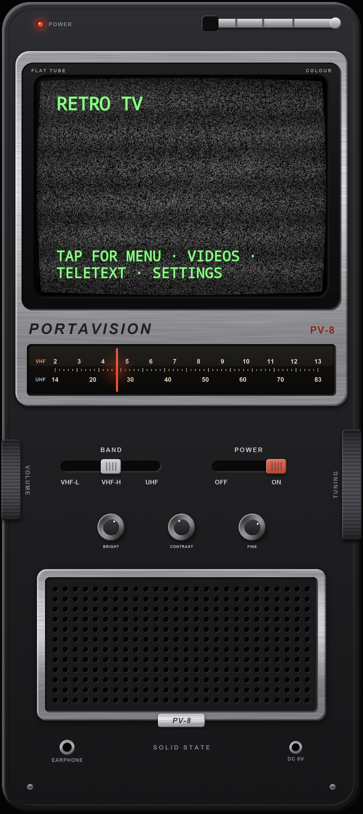
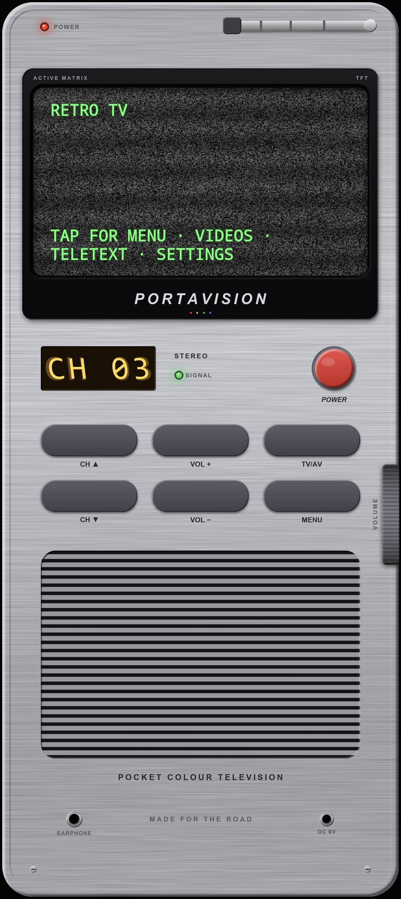
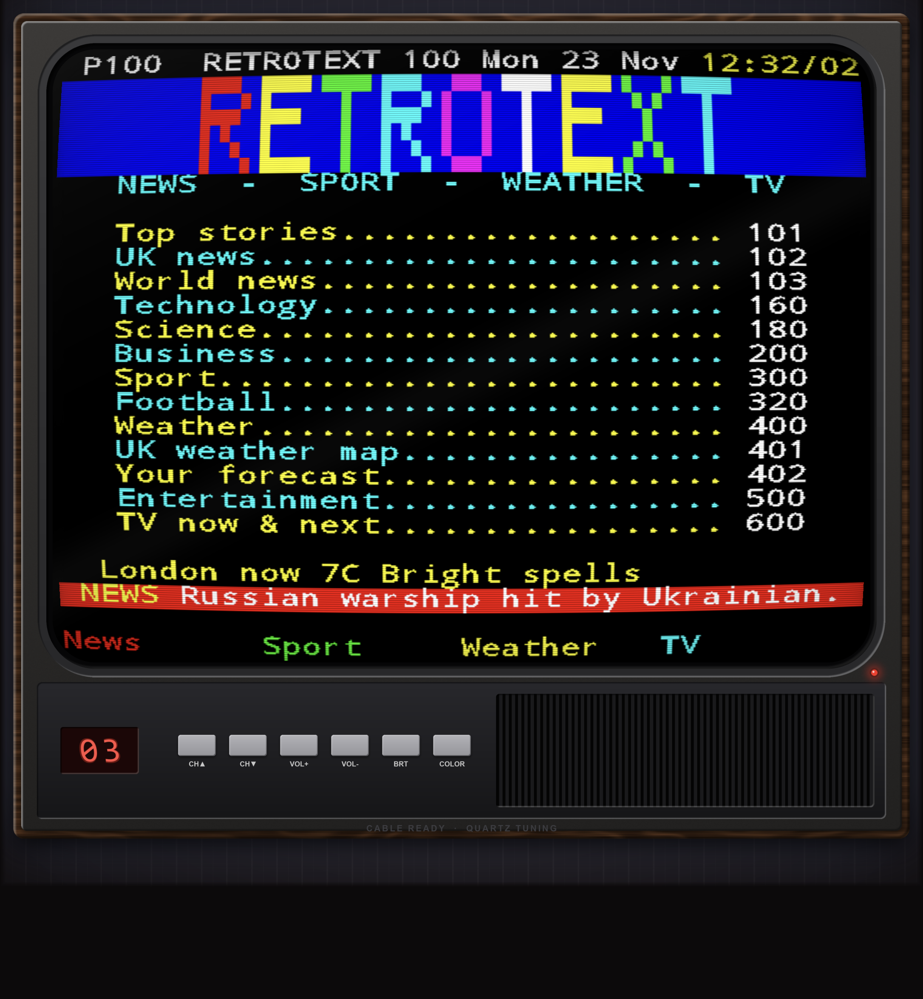
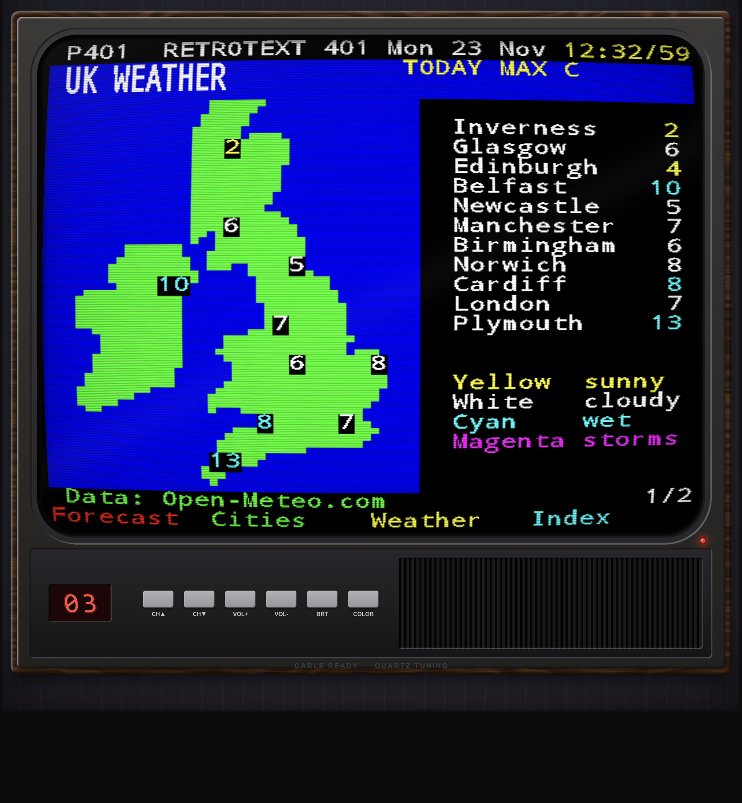
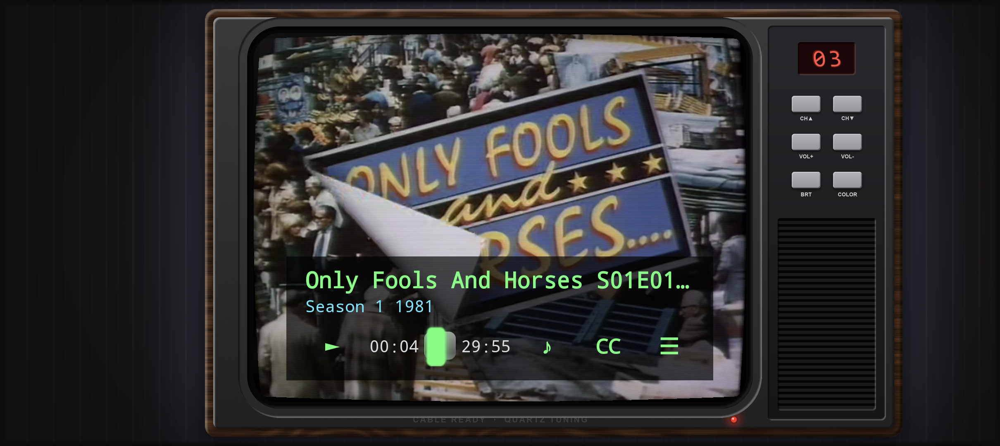

# Retro TV

A lightweight, retro-styled Android video and IPTV player wrapped in **procedurally generated CRT & pocket TV bezels**, a real-time **OpenGL ES 2 CRT shader**, and **RETROTEXT** — a live 40×25 Ceefax-inspired teletext service rendered right onto the curved glass tube.

- **Zero ads, zero analytics, zero bloat** — pure Java + Media3 ExoPlayer.
- **Works out of the box without an IPTV account** — watch your own local videos and browse live Teletext immediately, or optionally connect your own Xtream Codes server.
- **Adaptive layouts for phones, tablets, and foldables** — automatically switches between a 1980s/90s **Pocket TV** in portrait (with working tactile tuning/volume wheels & membrane buttons), a **square TV** on foldable inner screens, and a **landscape wood-grain CRT / widescreen flat CRT**.

> **Disclaimer:** Retro TV includes **no TV channels, playlists, or media content**. You supply your own local video files or legal IPTV provider credentials.

---

## Screenshots

<p align="center">
  
  
</p>
<p align="center">
  
  
</p>
<p align="center">
  
</p>

---

## Features

### Adaptive TV Bezels & Tactile Controls
- **Classic CRT (`tvcrt`)** — wood-grain 4:3 television in landscape/square, and the **PORTAVISION PV-8** charcoal pocket CRT in portrait with **working side tuning & volume thumbwheels** (drag to step with haptic ticks, or tap upper/lower halves).
- **Widescreen TV (`tvwide`)** — dark flat-tube 16:9 TV in landscape/square, and a **90s silver pocket LCD** in portrait with **working `CH ▲/▼`, `VOL +/-`, `TV/AV`, `MENU`, `POWER` standby buttons**, and side volume wheel.
- **Real-time OpenGL ES 2 CRT shader** — curvature, phosphor scanlines, vignette, aspect-ratio letterboxing, and animated TV static while tuning or buffering.
- All bezel artwork is drawn 100% procedurally by [`tools/make_bezels.py`](tools/make_bezels.py).

### RETROTEXT (Live Teletext)
- Authentic **40×25 character grid** with 8 teletext colours, double-height headlines, 2×3 block-graphics mosaics, rolling page-search header, subpages, **MIX** (transparent over TV), and **HOLD**.
- **Live News** (pages `101`–`500`) from BBC News public RSS feeds.
- **Live Weather** (pages `400`–`403`) powered by Open-Meteo, including a **block-graphics UK weather map** and a 7-day forecast for your chosen town (set in Settings).
- **TV Now & Next** (pages `600`+) built from your favourite IPTV channels, with one-tap **Red button → Watch**.

### Local Videos
- Browse device video folders via Android MediaStore (`READ_MEDIA_VIDEO`), or tap **+ Add a folder** to pick any folder on internal storage or SD card (including folders containing `.nomedia` files).
- Auto-selects the 4:3 CRT or 16:9 TV bezel based on video aspect ratio, remembers resume positions, auto-plays the next file in the folder, and supports `"Open with Retro TV"` (`ACTION_VIEW`) from file managers and frontends like ES-DE.

### Optional Xtream Codes IPTV, EPG & VOD
- Live TV categories, favourites, MPEG-TS with automatic HLS fallback, and built-in **FFmpeg software audio decoding** (MP2, AC-3, E-AC-3, DTS) via Jellyfin's Media3 decoder.
- Optional **Software H.264 decoder** toggle in Settings for devices whose hardware decoder struggles with interlaced DVB broadcast streams.
- **24-hour Teletext-style TV Guide** with lazy, rate-limited EPG loading so providers don't throttle your account.
- **Films, Shows & Universal Search** with disk caching, posters, season/episode tracking, audio/subtitle track switching, resume points, and next-episode auto-play.

---

## Controls

| Action | Touch | Pocket TV (Portrait) | Controller / D-Pad |
| :--- | :--- | :--- | :--- |
| Channel / Menu panel | Tap screen | `MENU` button | `A` / `Enter` |
| Change channel | Swipe up / down | Tuning wheel / `CH ▲▼` | `D-pad ↑↓` / `L1` `R1` |
| Volume | Hardware buttons | Volume wheel / `VOL +-` | — |
| TV Guide (EPG) | Swipe left / right | — | `Select` / `Guide` |
| RETROTEXT Teletext | `TXT` in menu | `TV/AV` button | `Start` / `T` |
| Switch CRT / Widescreen bezel | Long-press screen | Long-press screen | `X` |
| Channel info / codec OSD | Double-tap (live TV) | — | `Y` / `Info` |
| Standby (screen off) | — | `POWER` button | — |
| Video seek ±10 s / ±1 min | Double-tap sides / swipe | Tuning wheel (±10 s) | `D-pad ←→` / `L1` `R1` |

---

## Download & Install

1. Download the latest signed `.apk` from the [**Releases**](https://github.com/sam-blakeman/retrotv/releases) page.
2. Open it on your Android phone (Android 8.0 / API 26 or newer) and allow installing from your browser/file manager if prompted.
3. On first launch, tap **Skip — Local & Teletext** to jump straight in, or enter your Xtream Codes IPTV credentials.

*(Tip: You can also track updates automatically using [Obtainium](https://github.com/ImranR98/Obtainium) pointed at this repository.)*

---

## Building from Source

Requirements: **JDK 17** and **Android SDK (API 35)**.

```bash
git clone https://github.com/sam-blakeman/retrotv.git
cd retrotv

# Build a debug APK
./gradlew assembleDebug
```

The APK is output to `app/build/outputs/apk/debug/app-debug.apk`.

### Signed Release Builds (APK & Play Store AAB)
1. Generate a keystore with `keytool` (keep it safe and **never** commit it).
2. Copy `keystore.properties.example` to `keystore.properties` (gitignored) and fill in your keystore path/passwords.
3. Run:
   ```bash
   ./gradlew assembleRelease   # signed release APK
   ./gradlew bundleRelease     # signed Android App Bundle (.aab)
   ```

### Regenerating Bezel Artwork
See [`tools/README.md`](tools/README.md) for instructions on running `tools/make_bezels.py` (Python + NumPy + Pillow).

---

## Privacy & License

- **Privacy:** See [`PRIVACY.md`](PRIVACY.md). Retro TV collects no user data and sends no analytics.
- **License:** Licensed under the **GNU General Public License v3.0** — see [`LICENSE`](LICENSE).
- **Third-party libraries & data:**
  - [AndroidX Media3 / ExoPlayer](https://github.com/androidx/media) (Apache 2.0)
  - [Jellyfin Media3 FFmpeg Decoder](https://github.com/jellyfin/jellyfin-androidx-media) (GPL-3.0)
  - Weather data by [Open-Meteo.com](https://open-meteo.com/) (CC BY 4.0)
  - News headlines from BBC News public RSS feeds
